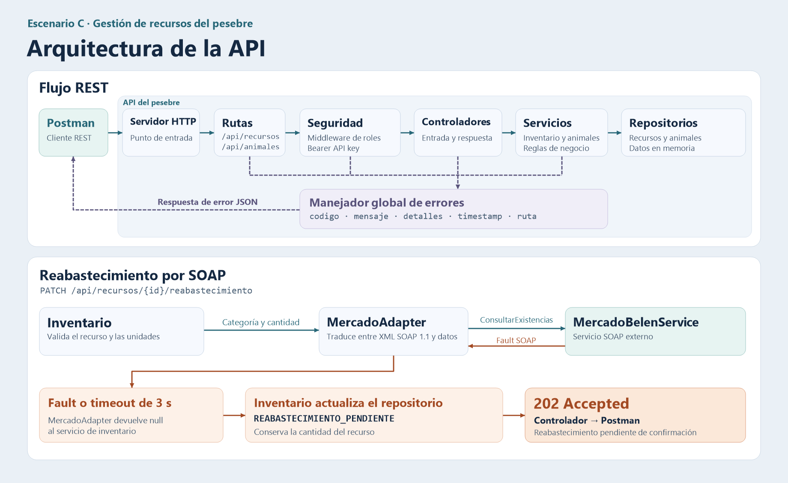

# Gestión de recursos del pesebre

Desarrollo Basado en Plataformas · Parcial 1 · Escenario C  
Rafael Alejandro Bermeo Macías

API REST para administrar el inventario del pesebre, registrar la alimentación de los animales y consultar al Mercado de Belén por SOAP al reabastecer.

## Arranque local

Desde la raíz del proyecto, usa Node.js 22.16 o superior. En PowerShell, instala las dependencias, genera las claves locales y arranca el servidor.

```powershell
npm ci
if (-not (Test-Path .env)) {
    Get-Content .env.example | ForEach-Object {
        if ($_ -like 'API_KEY_*=') {
            $_ + (node -p 'require("node:crypto").randomBytes(24).toString("hex")')
        } else {
            $_
        }
    } | Set-Content -Encoding ascii .env
}
npm start
```

La API escucha en `http://127.0.0.1:3000`. También puedes definir las variables directamente en el entorno antes de ejecutar `npm start`. El archivo `.env` se ignora en Git.

Para comprobar el arranque, ejecuta `curl.exe -i http://127.0.0.1:3000/api/recursos` en otra terminal. Una instancia nueva devuelve `200 OK` con `[]`.

### Variables de entorno

| Variable | Uso |
| --- | --- |
| `PUERTO` | Puerto local. Por defecto, `3000`. |
| `API_KEY_ENCARGADO_PESEBRE` | Clave del rol que protege las operaciones de escritura de recursos. |
| `API_KEY_PASTOR` | Clave para comprobar el caso de rol insuficiente. |
| `MERCADO_SOAP_URL` | Endpoint HTTP(S) del mock del docente. Usa la URL del servicio SOAP indicada en el WSDL. |
| `MERCADO_SOAP_ACTION` | Valor de `soapAction` que indica el WSDL para `ConsultarExistencias`, sin comillas exteriores. Si está vacío, se envía `SOAPAction: ""`. |

### Roles y tokens de prueba

Usa **Authorization → Bearer Token** en Postman con la clave de `.env`. Las operaciones protegidas requieren `ENCARGADO_PESEBRE`. Una clave válida de `PASTOR` devuelve `403`. Una clave ausente o inválida devuelve `401`. Configura dos claves distintas para probar ambos roles.

## Panel web local

Con el servidor en marcha, abre `http://127.0.0.1:3000/` para consultar y filtrar recursos y animales, registrar consumos y alimentar a los animales. Usa **Configurar clave** con el valor de `API_KEY_ENCARGADO_PESEBRE` para crear, consumir, reabastecer o eliminar recursos. La clave se mantiene en memoria mientras la pestaña está abierta.

**Actividad API** muestra el código HTTP y el JSON de las operaciones. Para reabastecimiento, compara la cantidad consultada antes de la petición con la cantidad de la respuesta. El resultado guardado aparece al actualizar el inventario. El código del panel está en `public/`.

## Arquitectura

[](docs/arquitectura.png)

Los controladores traducen las peticiones a llamadas a los servicios. Inventario aplica las reglas de stock y calcula el estado. Animales verifica la fecha de la última alimentación y usa el servicio de inventario para descontar la ración. Los repositorios de recursos y animales generan sus propios IDs y se vacían al reiniciar el servidor.

Inventario entrega la categoría y cantidad a `MercadoAdapter`. El adaptador traduce esos valores a XML SOAP 1.1 y aplica un límite de tres segundos a la petición y lectura de la respuesta. Inventario recibe el resultado y decide cómo actualizar el recurso. [Especificación SOAP 1.1](https://www.w3.org/TR/soap11/).

## Formato de errores

El manejador global devuelve `codigo`, `mensaje`, `detalles`, `timestamp` en UTC y `ruta`. Este es el cuerpo de un `409 Conflict` por consumo superior al stock.

```json
{
  "codigo": "STOCK_INSUFICIENTE",
  "mensaje": "El consumo supera la cantidad disponible",
  "detalles": [],
  "timestamp": "2026-12-25T04:00:00.000Z",
  "ruta": "/api/recursos/1/consumo"
}
```

## Inventario

| Petición | Acceso | Resultado |
| --- | --- | --- |
| `POST /api/recursos` | `ENCARGADO_PESEBRE` | `201` con el recurso y el encabezado `Location`. |
| `GET /api/recursos?categoria=PAJA&estado=DISPONIBLE` | Público | `200` con los recursos que cumplen ambos filtros. Cada filtro es opcional. |
| `GET /api/recursos/{id}` | Público | `200` con el recurso o `404` si el ID no existe. |
| `PATCH /api/recursos/{id}/consumo` | `ENCARGADO_PESEBRE` | `200` con el recurso actualizado o `409` si el stock es insuficiente. |
| `PATCH /api/recursos/{id}/reabastecimiento` | `ENCARGADO_PESEBRE` | `200` si el Mercado confirma existencias, `422` si dice que no hay o `202` si la consulta queda pendiente. |
| `DELETE /api/recursos/{id}` | `ENCARGADO_PESEBRE` | `204` si el stock es cero o `409` si aún hay existencias. |

En Postman, usa este cuerpo JSON para registrar un recurso.

```json
{
  "nombre": "Paja para el pesebre",
  "categoria": "PAJA",
  "cantidad": 10,
  "stockMinimo": 4
}
```

El servidor genera el ID y calcula el estado `DISPONIBLE`. Envía `{"cantidad": 7}` al endpoint de consumo con ese ID. Quedarán 3 unidades y el estado será `BAJO_STOCK`. Consume las 3 restantes para verificar `AGOTADO` y poder eliminar el recurso.

El alta requiere un nombre de 2 a 60 caracteres, una cantidad entera desde 0 y un stock mínimo entero desde 1. Las categorías son `PAJA`, `MANTA`, `AGUA`, `ALIMENTO_ANIMALES` y `LAMPARA_ACEITE`. Cada consumo requiere una cantidad entera positiva.

Los nombres se guardan sin espacios exteriores y se comparan sin distinguir mayúsculas. Un nombre duplicado devuelve `409`. Los datos o filtros inválidos devuelven `400`.

## Animales

Las tres rutas son públicas.

| Petición | Resultado |
| --- | --- |
| `POST /api/animales` | `201` con el animal registrado y `ultimaAlimentacion: null`. |
| `GET /api/animales?especie=BUEY` | `200` con los animales de esa especie. El filtro es opcional. |
| `PATCH /api/animales/{id}/alimentacion` | `200` con el animal actualizado, `404` si el ID no existe, `409` si falta alimento o `422` si ya comió ese día. |

Para registrar un animal en Postman, envía el nombre, una especie de entre `BUEY`, `MULA` y `OVEJA`, y una ración entera de 1 a 10 unidades.

```json
{
  "nombre": "Lucero",
  "especie": "BUEY",
  "racionDiaria": 3
}
```

Registra un recurso `ALIMENTO_ANIMALES` con al menos 3 unidades y llama a la ruta de alimentación con el ID del animal, sin cuerpo. El servicio toma el primer recurso por orden de creación que cubre la ración completa y recalcula su estado. La fecha se guarda como `AAAA-MM-DD` según la hora de Guayaquil. Si el animal ya comió ese día o falta alimento, se conservan la fecha y el inventario.

## Reabastecimiento

Agrega `MERCADO_SOAP_URL` y, si el WSDL indica un valor, `MERCADO_SOAP_ACTION` al archivo `.env`. Reinicia la API, registra un recurso y envía `{"cantidad": 20}` a su ruta de reabastecimiento con el token de `ENCARGADO_PESEBRE`.

- `DISPONIBLE` devuelve `200`, suma lo solicitado y recalcula el estado.
- `SIN_EXISTENCIAS` devuelve `422` con el formato estándar de error y conserva el recurso.
- Un Fault, timeout o respuesta inválida devuelve `202` con el recurso en `REABASTECIMIENTO_PENDIENTE`, la misma cantidad y un mensaje de confirmación pendiente. Con el mock del docente, usa `{"cantidad": 999}` para provocar el Fault.

Si falta la URL, las consultas de reabastecimiento se marcan como pendientes. Cuando el Mercado esté disponible, vuelve a enviar la solicitud para confirmarla. Después de un `202`, consulta `GET /api/recursos/{id}` para verificar el estado y la cantidad almacenados.

Ejecuta `npm test` para probar el reabastecimiento con un servidor SOAP local que simula las respuestas del enunciado.

## Colección de Postman

Importa [Escenario C · Gestión de recursos del pesebre](postman/escenario-c.postman_collection.json) y ejecuta la colección completa en orden con **Run collection**. Usa una instancia de pruebas de la API con el Mercado SOAP configurado. La colección crea recursos y un animal para cada ejecución. [Importación y exportación de colecciones](https://learning.postman.com/docs/getting-started/importing-and-exporting/exporting-data/).

En el entorno local de Postman, define `tokenEncargado` y `tokenPastor` con las claves respectivas de `.env`. La variable `baseUrl` usa `http://127.0.0.1:3000` por defecto. El JSON que se entrega lleva los tokens vacíos.

La colección comprueba `200`, `201`, `400`, `401`, `403`, `404`, `409`, `422` y `202`. En **Fault del Mercado de Belén**, la primera consulta guarda la cantidad, el reabastecimiento de 999 unidades comprueba el `202`, y la última consulta comprueba que el inventario conserva la cantidad inicial con el estado `REABASTECIMIENTO_PENDIENTE`.

## Respuesta de microservicios

Separaría el sistema en Inventario y Animales. Inventario tendría el ID, nombre, categoría, cantidad, stock mínimo y estado de cada recurso. Animales tendría el ID, nombre, especie, ración diaria y última fecha de alimentación de cada animal. Para alimentar, Animales pediría a Inventario descontar la ración antes de registrar la fecha. Usaría una clave por animal y día para evitar descuentos duplicados. El Mercado de Belén conservaría su catálogo y sus existencias por categoría.

Si el Mercado cae el 24 de diciembre a las 23:00, la API seguiría atendiendo consultas, consumos y alimentaciones con el stock disponible. Ante un Fault o al cumplirse tres segundos de espera, el reabastecimiento devolvería `202 Accepted`, conservaría la cantidad y marcaría el recurso como `REABASTECIMIENTO_PENDIENTE`. El encargado podría reenviar la solicitud cuando el Mercado se recupere.
